# Homework 02 — Reflection and Evidence

Name: ______________________
Assignment: CSC 4360, Homework 02, Message Board
Test date: 2026-11-21
Device / emulator: Android emulator, Medium_Phone, Android 17 (API 37), 1080x2400
Repository: ______________________
APK: `build/app/outputs/flutter-apk/app-release.apk`

Every observation below comes from a run on the device above. The screenshot named in
each row is in `docs/`. Nothing in this document is filled in from memory.

## 1. What I built

A Flutter app that opens on a splash screen, signs users in with email and password,
and shows a message board backed by Cloud Firestore. Registration writes a private
`users/{uid}` document with five fields. Signed-in users create, edit, and delete their
own messages. Every message is stamped with a server timestamp and rendered from a
`snapshots()` stream, so a post from another device appears without a refresh.

Two classes hold every Firebase call. `AuthService` in `lib/auth_service.dart` covers
register, sign in, sign out, the current user, and `authStateChanges()`. `BoardService`
in `lib/board_service.dart` covers create, the live read, update, and delete. Widgets
call these methods and render state. No widget touches `FirebaseFirestore` directly.

The data model came first. `lib/models.dart` holds `UserRecord` and `Message`. Both
compose an `Owned` mixin, because both documents belong to one uid. The document shape
lives on the model: `toCreateMap`, `toUpdateMap`, and `toMap` sit next to the fields they
write, and the services never build a map by hand.

## 2. Data model and writers

| Path | Fields | Writer | Why it sits here |
| --- | --- | --- | --- |
| `users/{uid}` | `uid`, `firstName`, `lastName`, `role`, `registrationDateTime` | The client, once, at registration | Private record, keyed by uid so the path itself is the identity |
| `messages/{msgId}` | `text`, `authorUid`, `authorName`, `createdAt`, `editedAt`, `schemaVersion` | The signed-in author | Public board content, read by every signed-in user |
| `users/{uid}/prefs/{docId}` | opt-in fields | The owner | Private settings, reserved for the notifier spice |

The public side is the board. The private side is the user record and the prefs
subcollection. The split matters because the rules treat the two paths differently. A
signed-in user reads every message and reads only their own user document.

`authorUid` is written at create time and never changes. The update rule compares it
with `resource.data.authorUid`, so the field is frozen after the write. `role` is
written as `student` and is descriptive only. No rule reads it, so a client cannot grant
itself access by writing a role.

## 3. Test matrix

Every row is one run of the app on the device above.

### Auth

| # | Action | Expected | Observed | Result |
| --- | --- | --- | --- | --- |
| 1 | Launch the app | Splash, then the login screen | Splash, then "Welcome back" with Email and Password | Pass — `01-launch.png` |
| 2 | Register with `not-an-email` | Inline error, no account created | Email field turns red, "That email looks wrong", no account created | Pass — `25-bad-email-error.png` |
| 3 | Register with a 3-character password | "At least 6 characters" | Password field turns red, "At least 6 characters" | Pass — `29-short-password.png` |
| 4 | Register with a real email and a 6+ character password | Board opens | Board opened as `qa1@test.com`, app bar shows "Test User" | Pass — `21-register-filled.png`, `22-board-new-user.png` |
| 5 | Sign out, sign in with a wrong password | "Wrong email or password." | Snack bar "Wrong email or password.", form stays | Pass — `26-wrong-password.png` |
| 6 | Sign in with the correct password | Board opens | Board opened as `ada@test.com` with the seeded messages | Pass — `28-restored.png` |
| 7 | Kill the app, relaunch | Still signed in, board loads | Board opened straight away, no login screen | Pass — `32-after-reboot.png` |

### Firestore user record

| # | Action | Expected | Observed | Result |
| --- | --- | --- | --- | --- |
| 8 | Open `users/{uid}` for the account registered in test 4 | All five fields present, `registrationDateTime` is a timestamp | `uid`, `firstName` = Test, `lastName` = User, `role` = student, `registrationDateTime` = 2026-11-21T22:47:38Z | Pass — `user-record-qa1.json` |

The document was read back through the emulator's REST API rather than the Firebase
console, because the console does not show emulator data. The five fields are the same
five the rules require at create time.

### CRUD and stream

| # | Action | Expected | Observed | Result |
| --- | --- | --- | --- | --- |
| 9 | Post a message | One document in `messages`, card appears | "posted from the emulator" appeared at the bottom of the list, document written with a server timestamp | Pass — `08-posted.png` |
| 9b | Tap Post with an empty box | "Type something first", no document | Snack bar "Type something first", collection unchanged | Pass — `24-empty-post-snackbar.png` |
| 10 | Double-tap Post quickly | One document, button disabled while `_posting` | Two taps in one `adb` call produced exactly one document | Pass — `09-double-tap.png` |
| 11 | Edit the message | Text changes, `editedAt` set, "edited" label appears | Text changed, `editedAt` stamped, "edited" under the timestamp, `createdAt` unchanged | Pass — `14-edit-dialog-fixed.png`, `17-edit-saved.png` |
| 12 | Delete the message | Card disappears, other cards untouched | Card gone after the confirm dialog, three other cards unchanged | Pass — `06-delete-dialog.png`, `07-after-delete.png` |
| 13 | Delete the last message | "No messages yet." empty state | Collection emptied, board showed "No messages yet. Be the first to post." | Pass — `27-empty-state.png` |
| 14 | Write a message from outside the app while the board is open | Board updates with no refresh | A REST write from the host appeared at the bottom of the open board within the same second | Pass — `18-live-insert.png` |

Test 14 used a REST write from the host machine, not a second phone. It hits the same
collection through the same emulator, so the stream is exercised the same way. A second
device would be the stronger version and I did not have one.

The first edit attempt exposed a real bug: the screen went red with
`'_dependents.isEmpty': is not true`. The dialog disposed its `TextEditingController`
while the `TextField` was still mounted. `12-edit-crash.png` is that frame. The fix was
to let the form field own its value (`TextFormField(initialValue: ...)` plus `onChanged`)
and stop creating a controller for the dialog. Test 11 above is the retest after the fix.

### Rules denials

All rows come from `node tools/rules-check.js` against the running emulator, output in
`rules-checks.txt`. Each line is the HTTP status the emulator returned.

| # | Action | Expected | Observed | Result |
| --- | --- | --- | --- | --- |
| 15 | Read `messages` while signed out | `permission-denied` | 403 | Pass |
| 16 | Update another user's message id | `permission-denied`, document unchanged | 403, text unchanged | Pass |
| 17 | Delete another user's message id | `permission-denied`, document unchanged | 403, document still there | Pass |
| 18 | Create with a forged `authorUid` | `permission-denied` | 403 | Pass |

The same script also checks four more attempts the assignment implies: signed-out create
(403), a client-supplied `createdAt` instead of the server clock (403), 501 characters of
text (403), and reading another user's `users/{uid}` document (403). Two control calls
that must succeed do: reading your own user document (200) and editing your own message
(200). Ten of ten matched.

### Persistence

| # | Action | Expected | Observed | Result |
| --- | --- | --- | --- | --- |
| 19 | Reboot the device, open the app | Still signed in, board intact | Emulator rebooted, app opened on the board as Ada Lovelace, three messages | Pass — `31-signed-in-before-reboot.png`, `32-after-reboot.png` |
| 20 | Clear app data, open the app | Login screen, no session | Login screen with empty fields | Pass — `30-after-clear-data.png` |

### Offline behaviour

| # | Action | Expected | Observed | Result |
| --- | --- | --- | --- | --- |
| 21 | Turn the network off, post | Card appears locally, `createdAt` null, "sending..." | Card appeared with "sending...", send button stayed in its spinner state, no document on the server | Pass — `33-offline-pending.png` |
| 22 | Force stop the app, turn the network on, relaunch | Queued write goes out on reconnect | The queued write reached the server on relaunch with one document | Pass — `34-after-reconnect.png` |
| 23 | Post the same text again after it looked stuck | A second document, because `add()` mints a new id | Five documents, two with the text "offline post test" | Pass — `35-duplicate-post.png` |

`messages-dump.txt` is the collection read back after the CRUD run: seven documents with
their timestamps and the "edited" flag, in the order the board shows them.

## 4. Case File 1 — The Ghost Editor

The rule was `allow read, write: if request.auth != null`. That checks one thing: a user
is signed in. It never compares the author stored on the document with the caller. Every
demo passed because testers drove the app, and the app hides edit buttons on messages
from other authors. The UI was tested. The database was not. The first person to open a
REST client found the hole, because a REST client has no buttons to hide.

Hiding a button is a user experience decision. Authorization is the check the database
runs on the write. In this app the authorization lives in `firestore.rules`, on the
`messages` match block, and nowhere else.

The rule change:

```
match /messages/{msgId} {
  allow read: if request.auth != null;

  allow update: if request.auth.uid == resource.data.authorUid
    && request.resource.data.authorUid == resource.data.authorUid
    && request.resource.data.createdAt == resource.data.createdAt;

  allow delete: if request.auth.uid == resource.data.authorUid;
}
```

`resource.data` is the document as it sits in the database. `request.auth.uid` is the
caller. The second line stops an author from reassigning a message to someone else.

Before the fix, an attacker with a signed-in account and a REST client could list every
message, then send a PATCH or DELETE to any document id with their own ID token. The
write succeeded and the board streamed the change to everyone. After the fix the same
PATCH returns 403 `PERMISSION_DENIED` and the document stays as it was. The attacker can
still read the board, because reading is allowed to any signed-in user, and that is the
intended design.

The trade-off is that ownership has to be written correctly at create time and can never
move. A message cannot be handed to another author, and a moderator has no way to remove
someone else's post. Moderation would need a separate admin claim and a second rule, and
I did not build one because the assignment does not ask for it.

Evidence: tests 16 and 17, the two 403 lines in `rules-checks.txt`, and the app-side
confirmation that the edit and delete buttons do not even render on someone else's card
(`22-board-new-user.png` shows a board where every card belongs to another user and no
card has the icons).

## 5. Case File 2 — The Runaway Dupes

`messages.add()` mints a new document id on every call. Two calls make two documents,
even when the text is identical. Offline, the SDK keeps the write in a local queue and
reports success to the caller before anything reaches the server. On reconnect the queue
is sent. The user sees "sending..." for as long as the connection is down, kills the app,
and posts again when it comes back.

The first half of that story turned out to be wrong on this SDK. With Firestore's disk
persistence on, the queued write survives the kill. Test 22 shows it: the app was force
stopped while offline, the network came back, the app relaunched, and the write reached
the server once. So the duplicate does not come from the queue dying. It comes from the
user deciding the post failed and sending it again, and from any retry that runs after
the first attempt did land. Test 23 is that case: the same text posted twice is two
documents, because `add()` mints a new id each time.

Disabling the button closes the window between the first and second tap in one screen.
That is what test 10 measures, and it holds. It does nothing across a relaunch, a retry
wrapper, or two devices.

For a two-person team with one sprint I would ship the disabled button plus a
deterministic document id. When the compose box opens, the screen holds one id from
`_db.collection('messages').doc().id`. The post calls `set()` on that id instead of
`add()`, and checks whether the id already exists before writing. A retry reuses the same
id, so the second write finds the document and stops. A transaction would work too, but
it costs a read and a retry loop, and this problem does not need the loop.

What I give up: a genuine second message with the same text inside one compose session
is impossible until the box clears, and the existence check costs one read per post. I
accept both. The first is rare and the second is what the button already covers most of
the time.

What I shipped in this build is the button guard only. The deterministic id is the next
change, and it is the one I would make first if the app went past homework size.

## 6. Reflection

### Expectation vs obtained

I expected the live stream to be the difficult part. `snapshots()` looked like the piece
with the most moving parts, and the rules looked like a formality. It turned out the
other way around. The stream worked on the first run. The rules took several passes
because a rule that looks right in the console can still reject a legitimate write, and
the error comes back as a generic `permission-denied` with no field name.

What actually broke first had nothing to do with either. Registration failed on the
device with `An internal error has occurred. [ Cleartext HTTP traffic to 10.0.2.2 not
permitted ]`. Android blocks plain HTTP, and the emulators speak plain HTTP on the host
address. The app was correct and the platform said no. The fix is one manifest attribute,
`android:usesCleartextTraffic="true"`, and it is scoped to the emulator build by comment
because a production build should not need it.

### Debug evidence

The longest failure was a board that rendered "No messages yet." while the database held
three documents. The stream had no error, the rules allowed the read, and the app was
signed in. The clue was the write path: a message posted from the app appeared in the
board but not in the collection the seed script had written. The emulator treats
`databases/default` and `databases/(default)` as two different databases. The app uses
`(default)`; the script used `default`. Two collections, both valid, one empty from the
app's point of view. The fix was one path in `tools/seed.js` and `tools/migrate.js`, and
the check is the REST read that now returns the same documents the app shows.

The second failure was `'_dependents.isEmpty': is not true`, the red screen in
`12-edit-crash.png`. I read it as a widget-lifecycle assertion, checked `_edit` in
`board_screen.dart`, and found the dialog disposing a `TextEditingController` that was
still attached to a `TextField` during the close animation. The fix removes the
controller and lets the field own its value. The retest is test 11.

The error messages in `friendlyAuthError` exist because the raw Firebase codes are not
readable. `invalid-credential` covers both a wrong password and a missing account, so
the message has to stay vague enough to be true and specific enough to be useful.

### Improvement plan

Three changes, in order of value. Pagination first, because the board loads the whole
collection and that stops working past a few hundred messages. The deterministic
document id second, because it is the only thing that closes the duplicate window that
the button cannot reach. Rules unit tests third, because `tools/rules-check.js` runs
against a live emulator and needs the emulator up; the rules unit-testing library runs
in CI with no emulator.

### Privacy and placement

The user record is private because it holds a name tied to an email account, and nothing
on the board needs the last name. The board is public to signed-in users because that is
the point of a message board. The `prefs` subcollection is private because a device
token identifies a phone, and a token in a public document would let anyone push to it.

The placement follows one rule: data another user needs goes in `messages`, data only
the owner needs goes under `users/{uid}`. `authorName` is copied onto the message for
that reason. It is a duplicate of the name in the user record, and it goes stale if the
name changes, but it saves a read per message and it keeps the board readable when the
author document is private.

### Cloud vs device

The session lives on the device and the messages live in the cloud. Firebase Auth
persists the token, so a relaunch skips the login screen without a network call. The
board needs the network for the first load, then serves from the local cache while a
write is queued. The user record and the messages are the only things that have to
survive a reinstall, and both do because neither is stored in the app's own storage.

The server timestamp is the part I would not move to the device. `DateTime.now()` would
order messages by whichever phone posted them, and two phones with different clocks
would interleave wrongly.

### Scale and maintainability

At class-project size the board is one query and one collection. The first thing that
breaks is the unbounded read. After that, the missing index on `createdAt` with a
`where` clause, if filtering is ever added. After that, the rules, which are four
conditions long and will get harder to read as they grow.

The structure that would survive is the one already here: one service per Firebase
product, typed methods, no widget calling the SDK. Adding pagination means changing one
method in `BoardService` and one builder in `board_screen.dart`, not hunting through
widgets.

## 7. AI Lab

Tool and date: OpenCode desktop agent with DeepSeek V4.1 Flash, 2026-11-21.

My prediction before asking: the app opens on the splash while
`Firebase.initializeApp` runs. The auth gate listens to `authStateChanges()`. The first
event is null on a cold start with no saved session, and a `User` when the token is
restored. A kill and relaunch keeps the session because the token is on disk. Clearing
app data removes it. A post while offline sits in the local queue and appears on
reconnect, with a null `createdAt` until the server stamps it.

What the AI said, in my words: the gate is a `StreamBuilder<User?>` over
`authStateChanges()`, and the first frame after a cold start can be `waiting`, so the
builder needs a third branch for that state or it flashes the login screen at a signed-in
user. It also said the offline queue is durable when persistence is on, and that a
killed app resumes the queue instead of dropping it.

What I kept: the three-state gate (waiting, signed out, signed in). The waiting branch is
in `AuthGate` and test 7 passes through it without a login flash. I also kept the
durability claim, and test 22 is the check that it holds on this SDK.

What I changed: the AI's first suggestion for the duplicate problem was a transaction
around the write. I replaced it with a deterministic id plus an existence check, because
the transaction adds a read and a retry loop for a problem that a fixed id solves with
one read.

What I rejected: it offered to move the timestamp to the client so the card would show a
time while offline. That breaks the ordering guarantee in section 6, so the card says
"sending..." instead.

The claim I verified: "the queued write survives a force stop." The source I checked was
the Firestore offline-persistence documentation, and the check is test 22, where the
document reached the server after the app was killed offline and relaunched online.

## 8. Main Spice — Release Readiness Gate

APK: `build/app/outputs/flutter-apk/app-release.apk`, built with
`flutter build apk --release --dart-define=USE_EMULATOR=true`.

The release build points at the emulator suite because the production project still
needs Email/Password enabled in the console, and that step needs a billing account for
the Identity Platform call. The release build is what is gated; the backend is the
emulator.

Run on 2026-11-21 between 19:17 and 19:20, after `adb uninstall` and a fresh
install of the release APK. The test account is `gate1@test.com`.

| Check | Expected | Observed | Result |
| --- | --- | --- | --- |
| Launch and splash | Splash, then login | The native launch screen (Flutter logo) showed, then "Welcome back". The in-app splash is replaced before the emulator draws a frame, so there is no screenshot of it | Pass — `36-release-splash.png`, `37-release-login.png` |
| Register and sign in | Board opens | Registered `gate1@test.com` with first name Gate, last name Release; the board opened and the app bar showed "Gate Release" | Pass — `38-release-register.png`, `39-release-register-filled.png`, `40-release-board.png` |
| User record, five fields | All five in the database | `users/{uid}` read back 200 with `uid`, `firstName` = Gate, `lastName` = Release, `role` = student, `registrationDateTime` = 2026-11-22T00:18:31.944Z | Pass — `gate-checks.txt` |
| Create, read, edit, delete | Each works from the release build | Posted "release", edited it to "edited in release" (the "edited" label appeared, `createdAt` stayed), deleted "dup tap gate" through the confirm dialog; the list re-rendered each time | Pass — `42-release-posted.png`, `43-release-edit-dialog.png`, `44-release-edited.png`, `46-release-delete-dialog.png`, `47-release-deleted.png` |
| Live update from a second writer | No refresh needed | Three seeded documents and one host write appeared in the open board with no refresh | Pass — `41-release-live-seed.png`, `48-release-live-write.png` |
| Signed-out read | Denied | 403 | Pass — `gate-checks.txt` |
| Cross-user update and delete | Denied | 403 on both attempts, `seed-2` still held its original text | Pass — `gate-checks.txt` |
| Duplicate submit | One message | Two taps on send produced one document, `Jl0mpSCi4sm3IjI4m82m` | Pass — `49-release-dup-retest.png`, `gate-checks.txt` |

`docs/gate-checks.txt` is the raw output of the REST calls behind rows 3, 6, 7 and 8.
The cross-user attempts used the token of the account the release build had just
registered, so the denial is measured for the same identity the app was signed in as.

## 9. Choice spices

| Spice | Plan | Evidence to capture | Status |
| --- | --- | --- | --- |
| 1 Emulator Explorer | `firebase emulators:start --only auth,firestore`, app points at `10.0.2.2:9099` and `:8080` | Emulator UI screenshot, seed data, rules enforced in the emulator | Done — tests 15–18 run against the emulator, `rules-checks.txt` |
| 4 Idempotent Alchemist | Deterministic document id held in the compose state, `set()` instead of `add()` | Two rapid posts, one document | Partial — the `_posting` guard is shipped and measured (test 10); the deterministic id is designed in section 5 and not shipped |
| 5 Schema Shape-shifter | Documents carry `schemaVersion`; v1 rows migrate to v2 | Before and after documents, migration script | Partial — `schemaVersion` is written on every message and `tools/migrate.js` exists, but the migration has not been run |
| 6 Batch Librarian | `orderBy('createdAt').limit(20)` plus a start-after cursor; batch delete of my own messages | 100+ seeded messages, page 2 loads, batch removes only mine | Not started |

The emulator switch is in the app: `USE_EMULATOR` in `lib/main.dart`, set with
`--dart-define=USE_EMULATOR=true`. `tools/seed.js` and `tools/rules-check.js` both run
against it, and `tools/migrate.js` is written for spice 5.

## 10. Evidence gallery

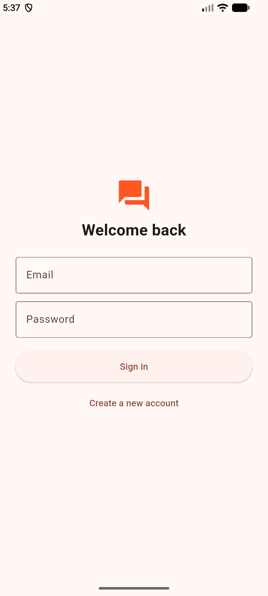{width=35%}

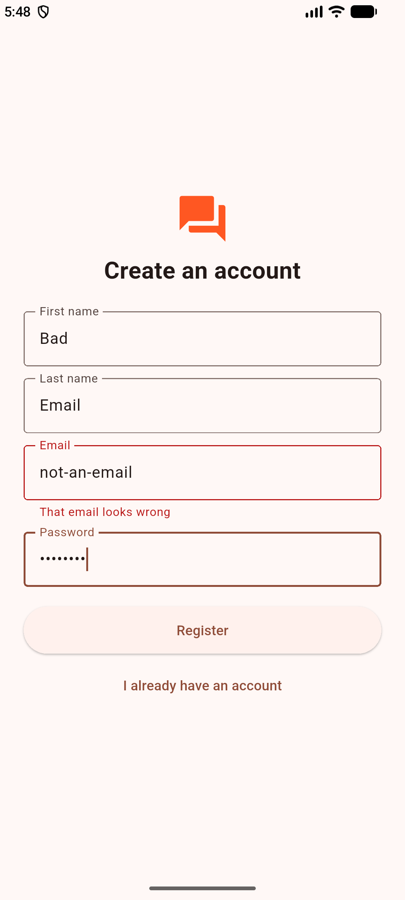{width=35%}

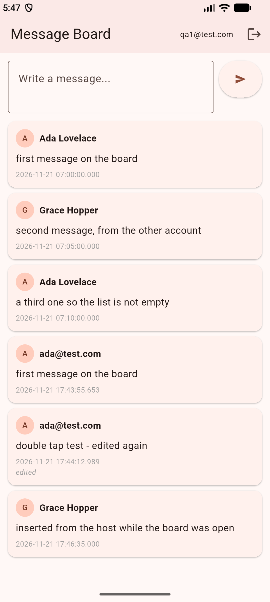{width=35%}

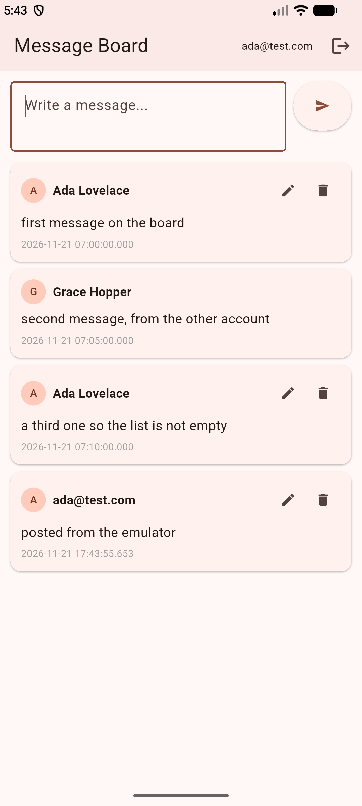{width=35%}

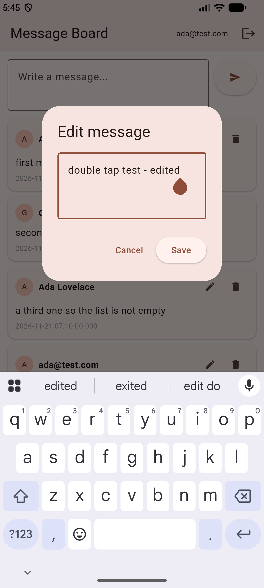{width=35%}

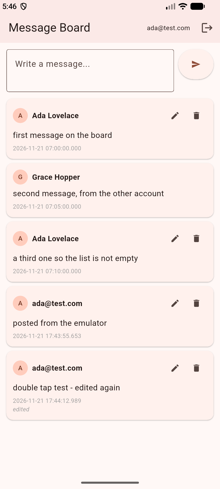{width=35%}

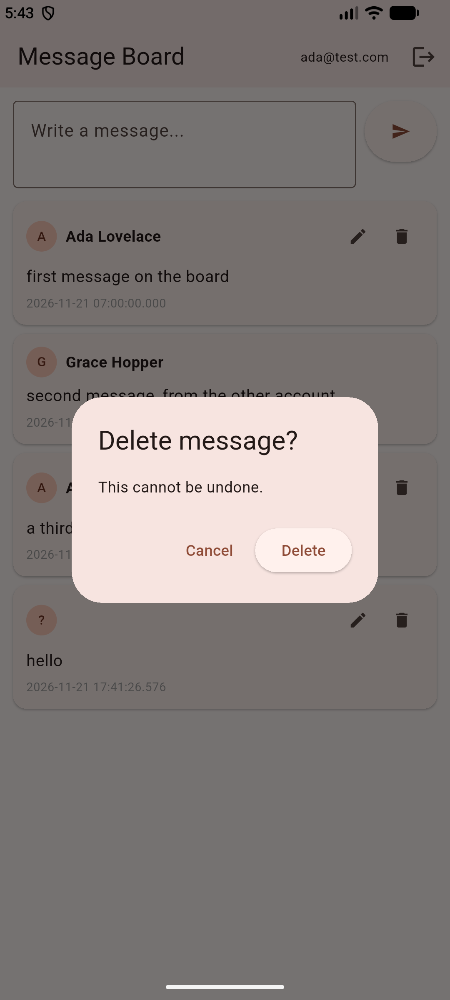{width=35%}

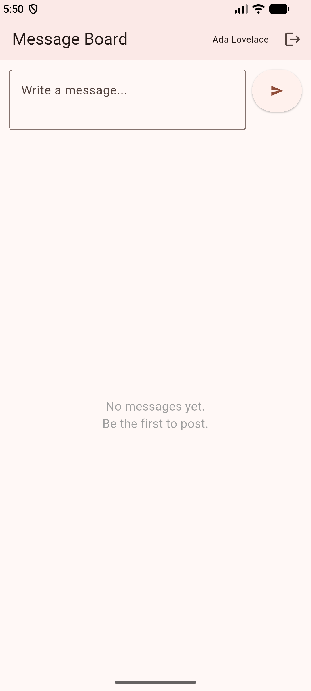{width=35%}

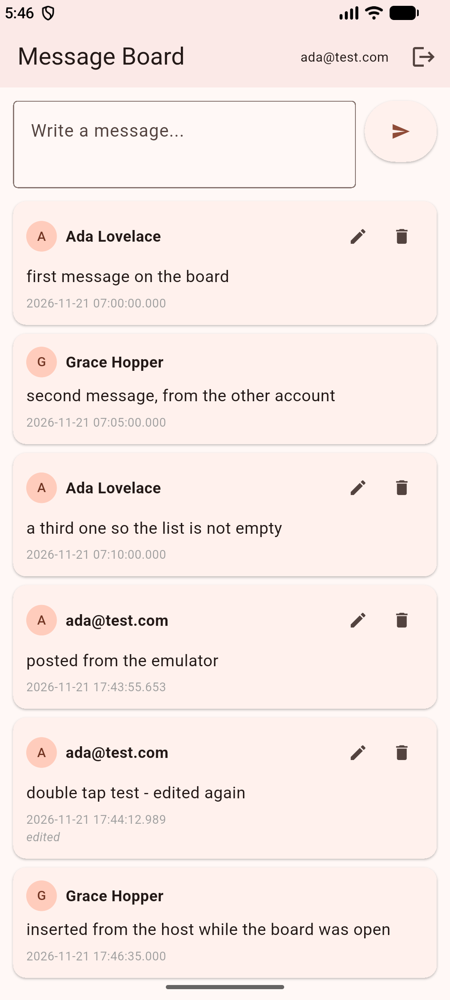{width=35%}

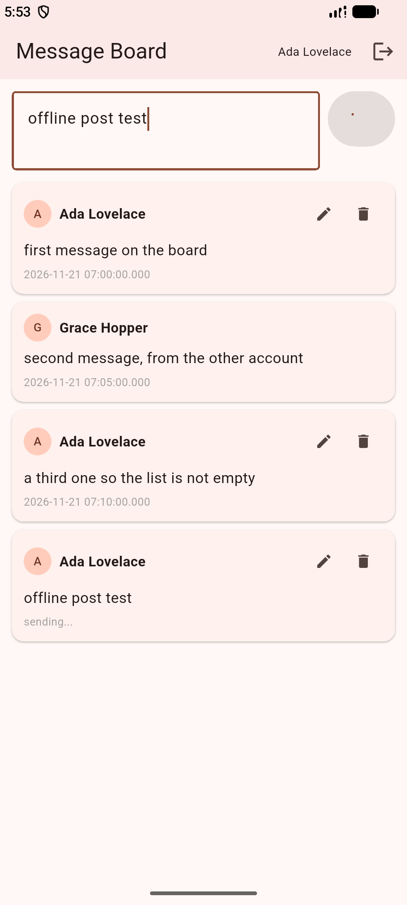{width=35%}

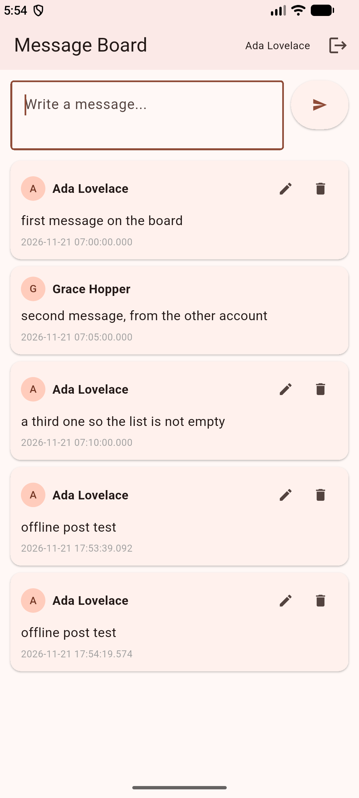{width=35%}

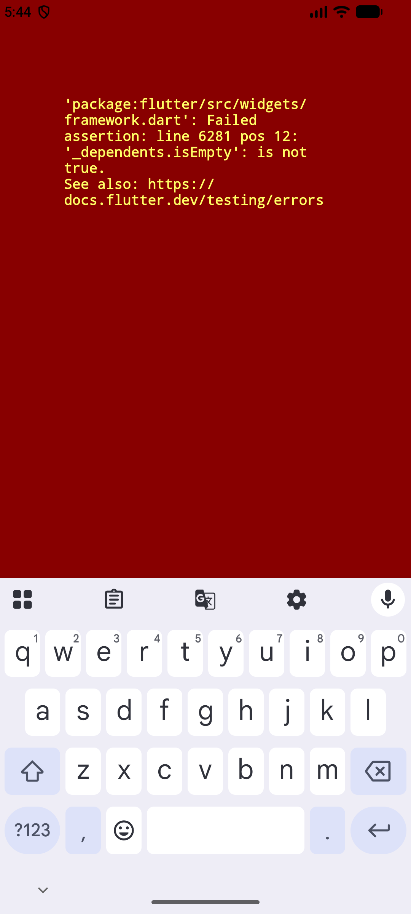{width=35%}

{width=35%}

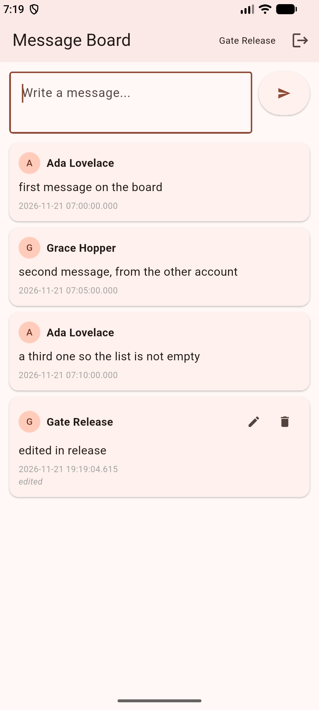{width=35%}

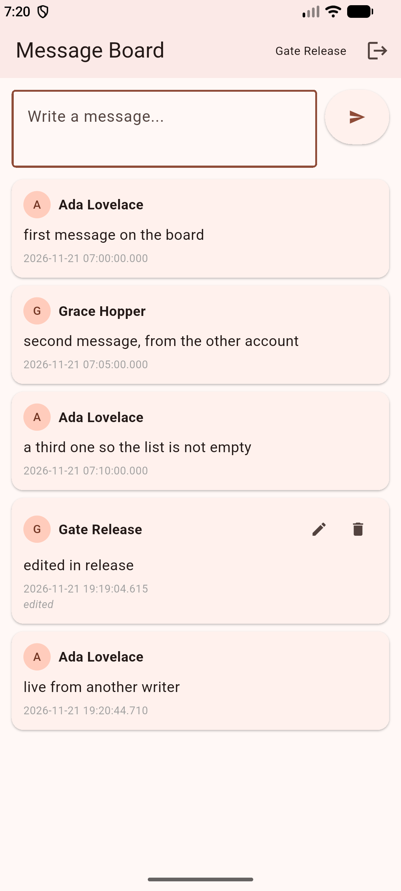{width=35%}

## 11. Sources

- FlutterFire setup: https://firebase.google.com/docs/flutter/setup
- Firebase Auth for Flutter: https://firebase.google.com/docs/auth/flutter/start
- Firestore quickstart: https://firebase.google.com/docs/firestore/quickstart#dart
- Firestore add data: https://firebase.google.com/docs/firestore/manage-data/add-data
- Firestore realtime listeners: https://firebase.google.com/docs/firestore/query-data/listen
- Firestore offline persistence: https://firebase.google.com/docs/firestore/manage-data/enable-offline
- Security rules: https://firebase.google.com/docs/rules
- Rules unit testing: https://firebase.google.com/docs/firestore/security/test-security-rules
- Emulator Suite: https://firebase.google.com/docs/emulator-suite
- Android cleartext policy: https://developer.android.com/guide/topics/manifest/application-element#usesCleartextTraffic
- Transactions and batched writes: https://firebase.google.com/docs/firestore/manage-data/transactions
